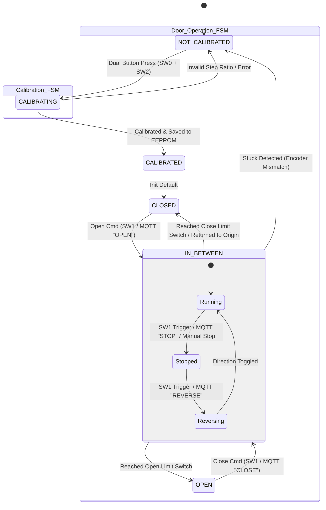

# Smart Embedded Door Controller (RP2040 / C++)

Embedded automatic door controller running on the **Raspberry Pi Pico (RP2040 MCU)**. Written in modern C++ utilizing the Pico SDK, this firmware implements deterministic Finite State Machines (FSM), interrupt-driven hardware events, dual-layer position & collision detection (Limit Switches + Rotary Encoder), EEPROM persistent recovery, and remote IoT telemetry via MQTT over Wi-Fi.

---

## Overview

Automated physical barriers demand absolute safety, real-time responsiveness, and seamless fault handling. This firmware controls a 4-coil stepper motor to drive a door mechanism between physical bounds while constantly monitoring movement metrics.

By coupling physical limit switch interrupts with real-time feedback from a quadrature **Rotary Encoder**, the system mathematically verifies motor execution step-by-step. If an obstacle prevents physical movement, the system instantly detects step desynchronization, triggers a safety fault, and notifies the network via MQTT.

---

## Key Technical Features

- **Thread-Safe LwIP/CYW43 Architecture:** Ensures safe asynchronous MQTT execution across background network worker threads using Pico SDK synchronization mutexes (`cyw43_arch_lwip_begin()` / `cyw43_arch_lwip_end()`).
- **Dynamic Mid-Travel Control (`STOP` & `REVERSE`):** Manual user override via switch (`SW1`) or MQTT command (`STOP`) halts movement immediately. Subsequent triggers (`REVERSE`) reverse the drive direction mid-travel.
- **Dual-Layer Position & Obstacle Tracking:** Combines hardware interrupts from physical limit switches with step-to-encoder pulse validation to detect stuck doors/obstructions.
- **Deterministic Finite State Machine (FSM):** Fully isolated calibration phases (`NOT_CALIBRATED`, `CALIBRATING`, `CALIBRATED`) and door operational states (`CLOSED`, `IN_BETWEEN`, `OPEN`).
- **EEPROM Fault Recovery:** Stores critical variables (state, direction, steps-per-encoder ratio, end-to-end limits) in non-volatile storage to allow automatic recovery (`recoverFromPowerOff`) from an error state.
- **Non-Blocking Asynchronous Operations:** Utilizes Pico absolute timers (`absolute_time_t`) for non-blocking status LED updates, Wi-Fi heartbeats, and MQTT event polling.
- **Remote IoT Control (MQTT):** Bi-directional command parsing (`OPEN`, `CLOSE`, `REVERSE`) and status publishing via Wi-Fi.

---

## Hardware & Sensing Architecture

| Component | Hardware Interface | Purpose / Description |
| :--- | :--- | :--- |
| **RP2040 MCU** | Raspberry Pi Pico SDK | Core microcontroller executing real-time control loops and ISR queues. |
| **Stepper Motor** | GPIOs (`PIN_COIL_1..4`) | 4-wire stepper motor for precise position-controlled opening/closing. |
| **Rotary Encoder** | Quadrature GPIOs (`PIN_ENCODER_A/B`) | Optical feedback tracking physical door travel relative to motor steps. |
| **Limit Switches** | Interrupt GPIOs (`PIN_SW0`, `PIN_SW1`, `PIN_SW2`) | Metallic end-stop plates triggering hardware interrupts at full physical bounds. |
| **EEPROM** | I2C / SPI Memory | Non-volatile storage for door state, direction, and encoder calibration data. |
| **Wi-Fi / MQTT** | On-board Wi-Fi | Wireless interface for remote MQTT broker communications. |

---

## System State Machine (FSM)

The door operates on a nested Finite State Machine supporting full mid-travel manual overrides:

---

## Authors & Contributors

Developed by:
- **Eeli**
- **Sami**
- **Max**
  
**Metropolia UAS**
---
